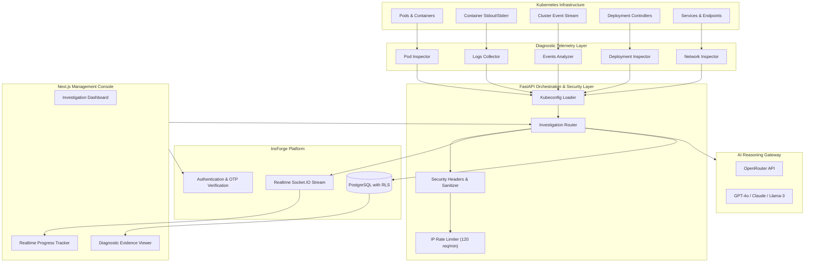

<div align="center">

# DevOps Kubernetes AI Troubleshooting Agent

**Autonomous SRE Investigation, Root Cause Analysis, and Cluster Diagnostics**

[](LICENSE)
[](https://www.python.org/)
[](https://fastapi.tiangolo.com/)
[](https://nextjs.org/)
[](https://www.typescriptlang.org/)
[](https://kubernetes.io/)
[](https://insforge.dev)

</div>

---

## Executive Summary

Kubernetes operational debugging requires SREs and platform engineers to manually correlate disparate data points across pod statuses, container error logs, cluster events, controller rollout histories, and service endpoint mappings. During production incidents, this manual correlation increases Mean Time to Resolution (MTTR).

The **DevOps Kubernetes AI Troubleshooting Agent** automates this investigative pipeline. It programmatically connects to configured Kubernetes contexts, extracts telemetry across five operational layers, filters sensitive credentials, correlates signals using Large Language Models via OpenRouter, and delivers an incident root-cause diagnosis paired with exact remediation commands.

---

## System Architecture



---

## Core Capabilities

### 1. Multi-Layer Telemetry Extraction
The collector layer queries the cluster through the standard Kubernetes API via `kubectl`:
- **Pod Inspector**: Audits pod lifecycles, exit codes, container restart counters, and failure phases (`CrashLoopBackOff`, `OOMKilled`, `ImagePullBackOff`, `ErrImagePull`, `Pending`, `Evicted`).
- **Logs Collector**: Extracts tail logs from failing container instances and filters common stack traces and operational exceptions.
- **Events Analyzer**: Captures cluster warning events within the target namespace to detect scheduling failures, node pressure, and volume mount timeouts.
- **Deployment Inspector**: Evaluates desired versus ready replica counts, update rollout progression, and probe failures (liveness, readiness, startup).
- **Network Inspector**: Evaluates service selector definitions against target pod labels to detect unrouted or dead service endpoints.

### 2. SRE Root Cause Reasoning Engine
- Aggregates multi-source diagnostics into an optimized prompt payload.
- Computes diagnostic confidence percentages.
- Outputs structured technical explanations, affected components, and copy-ready `kubectl` remediation commands.

### 3. Enterprise BaaS Integration (InsForge)
- **Identity & Access Management**: Secure email and password authentication with a mandatory 6-digit OTP verification workflow.
- **Row-Level Security (RLS)**: Enforces cryptographic user isolation on the PostgreSQL `investigations` table (`auth.uid() = user_id`).
- **Realtime Telemetry Streaming**: Uses PostgreSQL notification triggers to publish milestone events (`Checking Pods` -> `Reading Logs` -> `Analyzing Events` -> `AI Reasoning` -> `Root Cause Found`) over dedicated Socket.IO channels (`investigation:<user_id>`).

### 4. Production Security & Hardening
- **HTTP Security Headers**: Enforces `Strict-Transport-Security`, `X-Frame-Options: DENY`, `X-Content-Type-Options: nosniff`, and `Referrer-Policy: strict-origin-when-cross-origin`.
- **Sliding-Window Rate Limiting**: In-memory rate limiting throttles abuse at 120 requests per minute per IP address.
- **Input Sanitization**: Regular expression pattern validation on `context` and `userId` fields mitigates command injection and malformed requests.
- **Sanitized Logging**: Cluster secrets and sensitive environment variables are sanitized prior to model ingestion.

---

## Technical Stack

| Component | Technology | Specification / Role |
| :--- | :--- | :--- |
| **Frontend Framework** | Next.js 14 (App Router) | Server-rendered React console with TypeScript |
| **Styling** | Tailwind CSS 3.4 | Obsidian dark mode design system (`#070A0F`, `#0B0F19`, `#2563EB`) |
| **Iconography** | Lucide React | Unified vector iconography set |
| **State & Cache** | TanStack React Query v5 | Client-side caching and asynchronous query management |
| **Backend API** | FastAPI / Python 3.12 | Asynchronous ASGI service with Pydantic validation |
| **Cluster Interface** | Kubectl CLI / Kubernetes API | Direct containerized cluster communication |
| **AI Gateway** | OpenRouter SDK | Model orchestration (OpenAI GPT-4o, Anthropic Claude, Meta Llama) |
| **Backend-as-a-Service**| InsForge | PostgreSQL, RLS policies, Auth OTP, and Socket.IO Pub/Sub |
| **Hosting (Backend)** | Render | Containerized Docker deployment (`render.yaml`) |
| **Hosting (Frontend)**| Vercel | Global edge CDN deployment (`frontend/vercel.json`) |

---

## Failure Detection Matrix

| Failure Mode | Trigger Condition | Diagnostic Signal | Automated Remediation |
| :--- | :--- | :--- | :--- |
| **CrashLoopBackOff** | Exit Code 1 / Missing Configurations | Container restarts with missing secret / DB URL | Patch ConfigMap / Secret reference in Deployment spec |
| **OOMKilled** | Exit Code 137 / Exceeded Memory Limit | Pod terminated by Linux kernel OOM Killer | Increase `resources.limits.memory` in manifest |
| **ImagePullBackOff** | Non-existent image tag / Auth failure | Kubelet event `Failed to pull image` | Correct container image repository / patch ImagePullSecrets |
| **Pending Pods** | Insufficient CPU/Memory or Node Taints | Kubelet event `0/3 nodes are available` | Add cluster capacity, adjust resource requests, or add tolerations |
| **Selector Mismatch** | Service selector does not match Pod labels | Service exists but EndpointSlice has 0 targets | Align `spec.selector` in Service with Deployment template labels |
| **Probe Failure** | Readiness or Liveness probe HTTP failure | Unhealthy container restarts after probe timeout | Adjust `initialDelaySeconds`, path, or container port |

---

## API Specification

### `GET /health`
Validates backend operational readiness.
```json
{
  "status": "healthy",
  "service": "ai-kubernetes-agent"
}
```

### `GET /contexts`
Lists available Kubernetes contexts configured in kubeconfig.
```json
{
  "contexts": ["kind-kubernetes-demo-cluster", "arn:aws:eks:region:account:cluster/prod"],
  "current_context": "kind-kubernetes-demo-cluster",
  "kubeconfig_path": "/root/.kube/config"
}
```

### `POST /investigate`
Executes an end-to-end cluster investigation workflow.

**Request Payload:**
```json
{
  "userId": "usr_94a3bddb_4175",
  "context": "kind-kubernetes-demo-cluster"
}
```

**Response Payload:**
```json
{
  "status": "success",
  "message": "Diagnosis complete.",
  "result": {
    "root_cause": "Missing database credentials secret reference in deployment manifest",
    "suggested_fix": "kubectl set env deployment/payment-service DB_PASSWORD=vault-secret",
    "pods_inspected": 8,
    "logs_analyzed": 2
  },
  "diagnosis": {
    "root_cause": "Missing database credentials secret reference in deployment manifest",
    "explanation": "Container payment-service failed at startup with Exit Code 1 due to missing DB_PASSWORD.",
    "fix": "kubectl set env deployment/payment-service DB_PASSWORD=vault-secret",
    "kubectl_command": "kubectl describe pod -l app=payment-service",
    "prevention": "Implement admission controllers to validate required environment variables.",
    "confidence": 96
  },
  "investigation": {
    "pods": { "success": true, "healthy": false, "total_pods": 8 },
    "logs": {},
    "events": { "success": true },
    "deployments": { "success": true },
    "network": { "success": true }
  }
}
```

---

## Quickstart & Local Installation

### 1. Clone the Repository
```bash
git clone https://github.com/vishalmore90/DevOps-Kubernetes-AI-Agent.git
cd DevOps-Kubernetes-AI-Agent
```

### 2. Configure Environment Variables
Copy and configure the sample environment files:

**Backend (`backend/.env`):**
```env
OPENROUTER_API_KEY=sk-or-v1-your-openrouter-key
OPENROUTER_MODEL=openai/gpt-4o
INSFORGE_API_KEY=ik_your_insforge_api_key
INSFORGE_API_BASE_URL=https://<app-key>.ap-southeast.insforge.app
KUBECONFIG_PATH=~/.kube/config
ALLOWED_ORIGINS=http://localhost:3000,http://127.0.0.1:3000
```

**Frontend (`frontend/.env.local`):**
```env
NEXT_PUBLIC_API_BASE_URL=http://localhost:8000
NEXT_PUBLIC_INSFORGE_BASE_URL=https://<app-key>.ap-southeast.insforge.app
NEXT_PUBLIC_INSFORGE_ANON_KEY=anon_your_insforge_anon_key
```

### 3. Run Locally with Docker Compose
```bash
docker compose up --build
```
Access the application:
- **Web Console**: `http://localhost:3000`
- **Backend API**: `http://localhost:8000`
- **API Documentation**: `http://localhost:8000/docs`

---

## Verification & Testing

### Backend Unit Tests
Execute the automated pytest suite:
```bash
pytest tests/ -v
```
Test suite validates:
- API health and routing integrity
- Pydantic environment configuration and origin validation
- Kubeconfig context parsing
- InsForge realtime event emission over HTTP triggers

### Kubernetes Failure Simulation
Deploy sample failure manifests to test agent detection capabilities:
```bash
# 1. CrashLoopBackOff scenario
kubectl apply -f tests/scenarios/01-crashloop.yaml

# 2. ImagePullBackOff scenario
kubectl apply -f tests/scenarios/02-imagepull.yaml

# 3. OOMKilled scenario
kubectl apply -f tests/scenarios/03-oomkilled.yaml

# 4. Service selector mismatch scenario
kubectl apply -f tests/scenarios/04-service-selector.yaml
```

---

## Cloud Deployment

### Backend Deployment (Render)
The backend is packaged as a containerized service with `kubectl` pre-installed.
1. Connect this repository to your Render account.
2. Select **Docker** as the runtime.
   - **Docker Context**: `./backend`
   - **Dockerfile Path**: `./backend/Dockerfile`
3. Supply required environment variables (`OPENROUTER_API_KEY`, `INSFORGE_API_KEY`, `INSFORGE_API_BASE_URL`, `ALLOWED_ORIGINS`).
4. Set Health Check path to `/health`.
5. *(Optional)* For remote cluster access, supply cluster credentials via `KUBECONFIG_DATA` (base64-encoded YAML) or mount a Render Secret File at `/etc/secrets/kubeconfig.yaml`.

### Frontend Deployment (Vercel)
1. Import this repository in Vercel.
2. Set the **Root Directory** to `frontend`.
3. Provide environment variables:
   - `NEXT_PUBLIC_API_BASE_URL`: Your deployed Render API URL.
   - `NEXT_PUBLIC_INSFORGE_BASE_URL`: Your InsForge backend URL.
   - `NEXT_PUBLIC_INSFORGE_ANON_KEY`: Your InsForge anonymous key.
4. Deploy the service.

---

## Compliance and Data Governance

- **Telemetry Sanitation**: Diagnostic collectors inspect cluster status and logs. Sensitive strings (tokens, authorization headers, passwords) are filtered before transmission to the AI reasoning gateway.
- **Data Protection**: Personal data and incident records are governed by the platform [Privacy Policy](/privacy) and [Terms of Service](/terms).
- **Security Audit**: All version control history has been verified to be free of exposed secrets or private cluster credentials.

---

## License

This software is distributed under the terms of the **Apache License 2.0**. Refer to the [LICENSE](LICENSE) file for complete terms.
